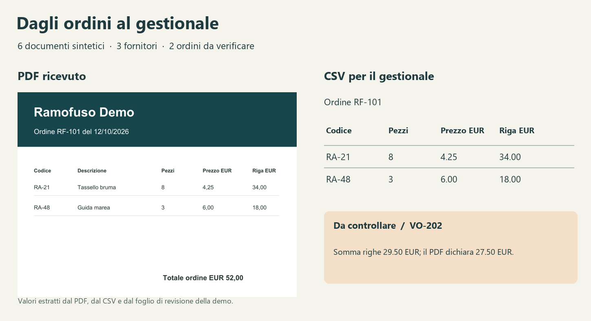

# Dagli ordini al gestionale · Orders to ERP

**Prima:** qualcuno ricopia articoli e prezzi da PDF ed email. **Dopo:** questa demo prepara un CSV con le righe riconciliate e un Excel che spiega quali ordini devono passare da una persona.
**Before:** someone rekeys items and prices from PDFs and email. **After:** this demo produces a CSV of reconciled line items and an Excel workbook explaining which orders need human review.



[Excel di esempio / Sample workbook](docs/ordini-esempio.xlsx) · [CSV di esempio / Sample import](docs/ordini-esempio.csv)

## Esecuzione · Run

Dalla cartella del progetto / From the project folder:

```sh
uv run demo.py
```

[uv](https://docs.astral.sh/uv/) installa le dipendenze al primo avvio. L’elaborazione è locale. / uv may download Python dependencies on the first run. All document processing is local.

Con Python 3.10+ già installato / Alternatively, with Python 3.10+:

```sh
python -m pip install -r requirements.txt
python demo.py
python -m unittest -v
```

## Cosa si può verificare · What to check

| Fornitore inventato / Fictional supplier | Formato / Format | Prova / Example |
|---|---|---|
| Ramofuso Demo | PDF tabellare con codice, descrizione, pezzi, prezzo e importo / multirow PDF table | RF-101: 34,00 + 18,00 = 52,00 EUR. Entrambe le righe nel CSV / both lines exported. |
| Officina Velombra Demo | PDF con un’intestazione e due righe di testo per articolo / PDF header and repeated item blocks | VO-202: le righe danno 29,50 EUR, il documento dichiara 27,50. L’intero ordine resta in revisione / whole order held. |
| Cartaonda Demo | Email in prosa, letta dal corpo MIME e abbinata al catalogo del fornitore / prose email matched to the supplier’s catalog | CO-302: il secondo prezzo è «da confermare». Anche la prima riga resta fuori dal CSV / both items withheld. |

Sei documenti, quattro ordini riconciliati, nove righe esportate per **177,50 EUR**. Gli altri due documenti rimangono in **Da controllare**. Il foglio **Ordini** riporta una riga per documento; **Righe** mostra gli articoli leggibili, compresi quelli trattenuti. Per una lettura parziale, «Somma righe EUR» rappresenta solo le righe lette.

Six documents, four reconciled orders, nine exported line items totalling **EUR 177.50**. The other two documents appear in **Da controllare** (Needs review). **Ordini** contains one row per document; **Righe** shows readable items, including withheld ones. For a partial read, the line sum only covers readable items.

## Importazione e limiti · Import and scope

- Il file **output/ordini.csv** usa UTF-8, separatore punto e virgola, date ISO e decimali con il punto. Ogni riga identifica fornitore, ordine, posizione e SKU. È un tracciato dimostrativo da mappare ai campi del gestionale di destinazione. / The CSV uses UTF-8, semicolons, ISO dates and a decimal point. Map its supplier, order, line number, SKU, quantity and amount fields to the target ERP before import.
- L’ammissione al CSV è automatica **per ordine intero**. Quantità × prezzo, importi di riga dichiarati e totale devono tornare al centesimo. Un identificativo duplicato per lo stesso fornitore, un prezzo dubbio, una voce sconosciuta o un profilo non riconosciuto richiedono revisione. Per correggere, aggiornare il documento sorgente e rieseguire. / Every line of an order is held if any check fails. Correct the source and rerun to regenerate both files.
- I tre profili riconoscono formati e frasi specifici. Nessun OCR, accesso a caselle email, interpretazione generica di allegati, supporto IVA/sconti o collegamento a un gestionale. Nessuna chiave né servizio AI a runtime. / The readers target three known layouts and a small prose vocabulary. Scans, arbitrary text, tax/discount calculations, inbox retrieval and live ERP posting are outside scope. No runtime AI service or key is needed.
- I campioni della prima demo rimangono in `samples/legacy/`. La modalità di controllo precedente continua a leggerli; non hanno SKU verificati per il CSV. / Previous single-item samples remain readable for review only.
- Vengono sostituiti i due file di uscita a ogni esecuzione. Se un'interruzione lascia un file `.export-lock`, rimuoverlo **solo dopo aver verificato che non sia in corso un’esportazione** e rieseguire. / Runs replace both outputs. After an interrupted run, confirm no export is active before removing a stale lock and rerunning.

```sh
uv run demo.py --input samples --output output/ordini.xlsx
uv run --with-requirements requirements.txt python -m unittest -v
```

Autore / Author: **antivex**. Costruito con supporto AI esclusivamente su dati sintetici. Built with AI assistance using entirely fictional data. [MIT License](LICENSE).
